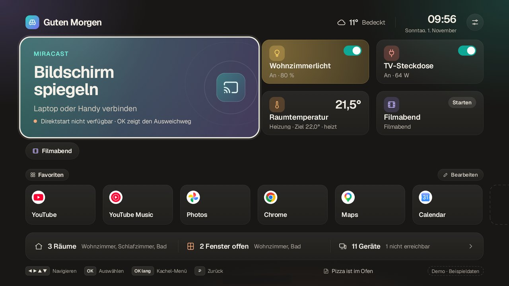
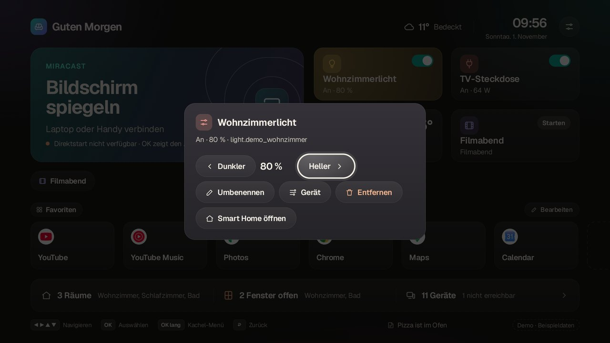
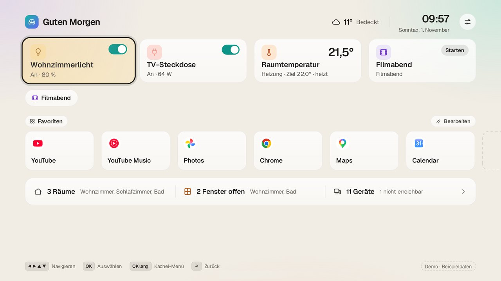
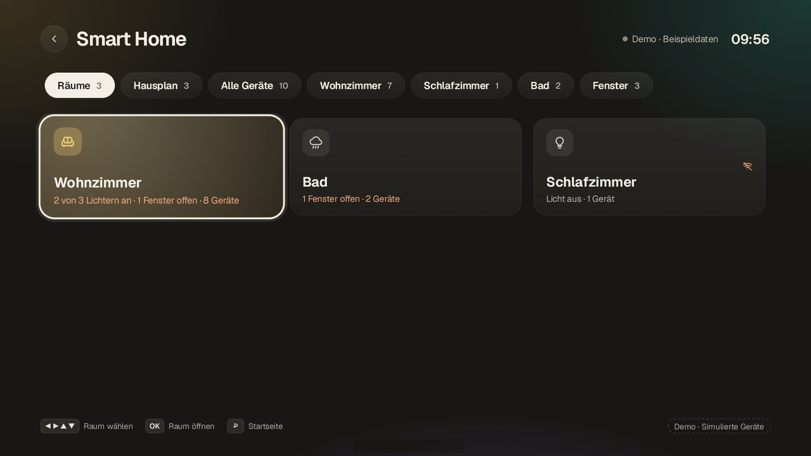
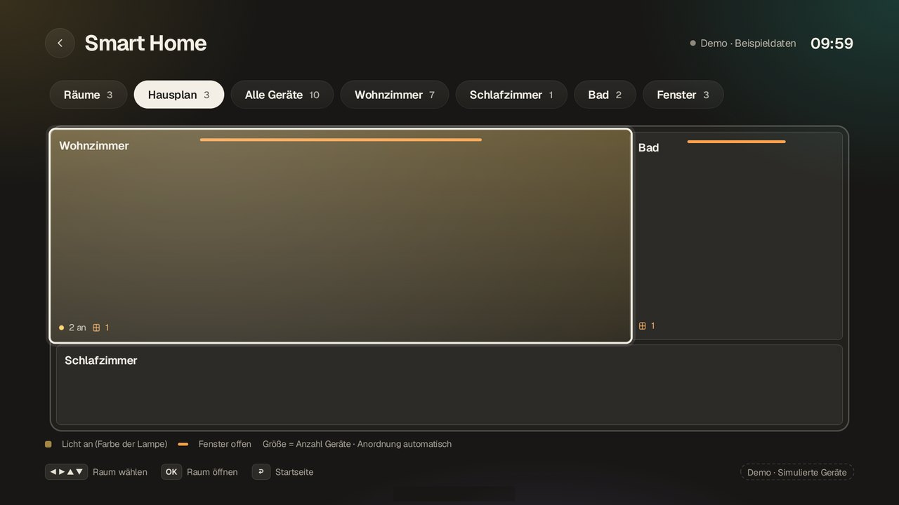
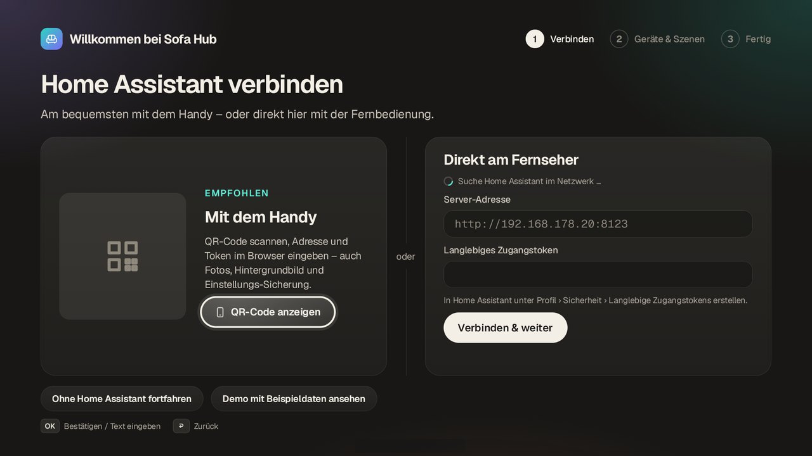
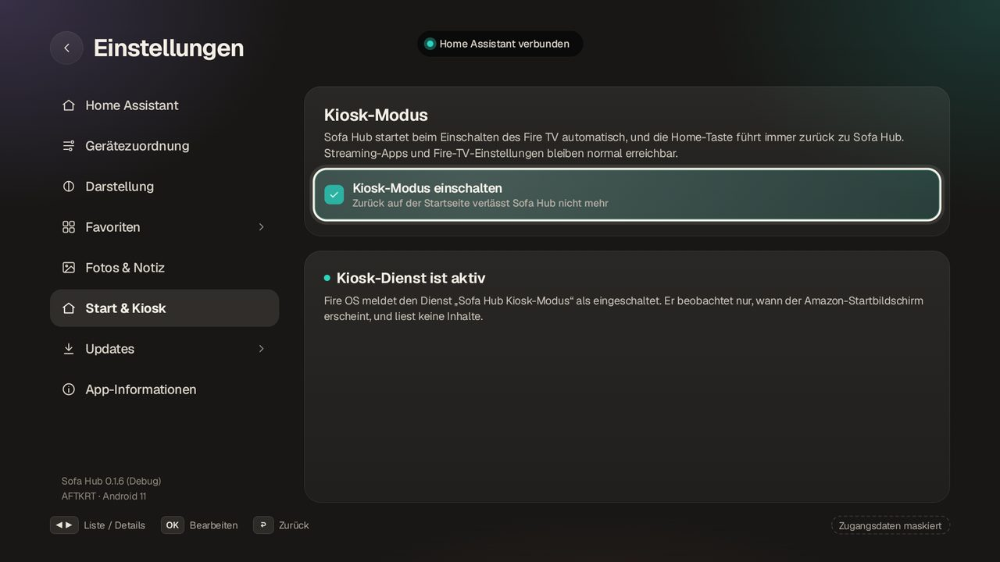
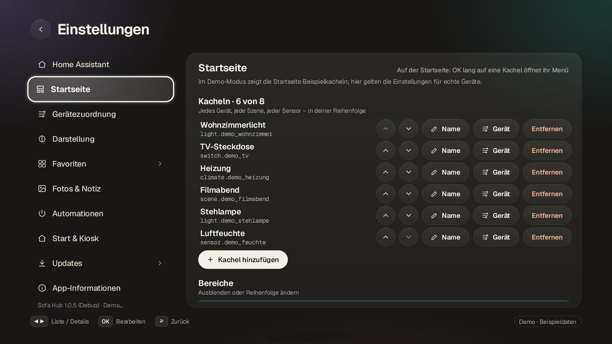
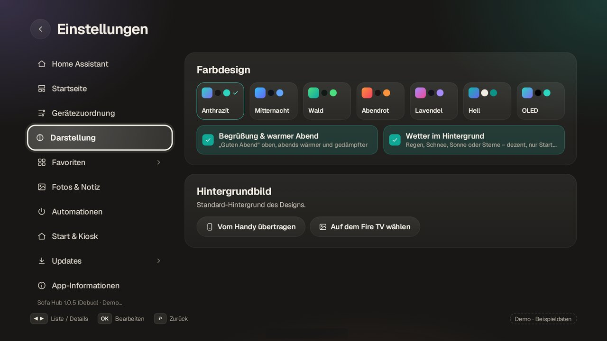

# Sofa Hub

**Das Wohnzimmer-Dashboard für den Amazon Fire TV Stick.** Ein Klick zum Bildschirm-Spiegeln, Home Assistant mit Live-Zuständen,
deine Streaming-Apps mit echten Logos, Szenen, Wetter, Termine und Hausübersicht – komplett mit der Fernbedienung bedienbar
und frei anpassbar.



| | |
|---|---|
|  |  |
|  |  |

Version 1.0.8 · entwickelt und getestet auf dem Fire TV Stick 4K Max (2. Generation, Fire OS 8.1.6.0) ·
[Kompatibilität](docs/COMPATIBILITY.md) · [Änderungen](https://github.com/thisislennard/SofaHub/releases)

## Inhalt

- [Funktionen](#funktionen)
- [Installation](#installation)
- [Einrichtung](#einrichtung)
- [Bedienung](#bedienung)
- [Bildschirm spiegeln](#bildschirm-spiegeln)
- [Kiosk-Modus](#kiosk-modus)
- [Automationen](#automationen)
- [Startseite anpassen](#startseite-anpassen)
- [Startseite: Drucker, Termine, Zuletzt genutzt](#startseite-drucker-termine-zuletzt-genutzt)
- [Fire TV in Home Assistant](#fire-tv-in-home-assistant)
- [Meldungen](#meldungen)
- [Aussehen, Fotos und Notiz](#aussehen-fotos-und-notiz)
- [Einstellungen sichern](#einstellungen-sichern)
- [Updates](#updates)
- [Fehlerhilfe](#fehlerhilfe)
- [Datenschutz und Sicherheit](#datenschutz-und-sicherheit)
- [Bekannte Einschränkungen](#bekannte-einschränkungen)
- [Entwicklung](#entwicklung)

## Funktionen

**Startseite**
- **Bildschirm spiegeln** – öffnet den eingebauten Miracast-Empfang des Fire TV mit einer Taste, mit Ausweichweg; zeigt,
  wann zuletzt gespiegelt wurde.
- **Freie Kacheln** – bis zu acht beliebige Geräte, Szenen oder Sensoren aus Home Assistant, in deiner Reihenfolge und mit
  eigenen Namen. Lichter leuchten in ihrer echten Farbe, Zahlenwerte zeigen eine 24-Stunden-Kurve.
- **Szenen-Leiste** – Lieblingsszenen und Skripte als Knöpfe.
- **Favoriten** – bis zu zwölf Apps mit echten TV-Logos; umschaltbar auf *Zuletzt genutzt*.
- **Hausübersicht** – Räume, offene Fenster, Geräte und was gerade nicht erreichbar ist.
- **Termine & Müllabfuhr**, **Wetter**, **Notiz** und **3D-Drucker-Kamera** (Bambu Lab, nur während eines Drucks).
- **Gäste-WLAN** – QR-Code als Kachel; Gäste scannen ihn mit der Handykamera und sind verbunden.
- **Anpassbar** – jeden Bereich ein-/ausblenden und umsortieren; es erscheint nur, was eingerichtet ist.

**Smart Home**
- **Raumkarten und Hausplan** – jeder Raum auf einen Blick, OK öffnet seine Geräte; Helligkeit per ◀ ▶.
- **Automationen** – Geräte schalten, wenn der Fire TV aus- oder eingeschaltet wird, und Lichtszenen oder Lichtfarben je App.
- **Fire TV in Home Assistant** – an/aus und laufende App als Entitäten für eigene HA-Automationen.
- **Meldungen** – Drucker-Fortschritt und gewählte Geräte (z. B. „Waschmaschine fertig“) kurz oben eingeblendet, auch
  während Netflix, YouTube & Co.

**Rund um die App**
- **Aussehen** – sieben Farbdesigns (darunter *Hell* und *OLED*), Begrüßung nach Tageszeit, wärmeres Bild am Abend,
  dezente Wetter-Animation, eigenes Hintergrundbild, Diashow.
- **Kiosk-Modus** – startet beim Einschalten, die Home-Taste führt zurück zu Sofa Hub (abschaltbar).
- **Einrichtung am Fernseher oder per Handy/PC-Browser** – Home Assistant wird im Netzwerk automatisch gefunden.
- **Einstellungen sichern** – als Datei über den PC-Browser, ohne Tokens.
- **Updates aus der App** – signierte APKs aus GitHub Releases, einmal täglich geprüft, immer mit Fire-TV-Bestätigung.
- **Flüssig auf dem Stick** – im Leerlauf zeichnet die Startseite praktisch nichts neu.

Sofa Hub ist eine normale App in der App-Bibliothek: kein Root, keine Cloud, kein Konto, kein dauerhaft eingeschaltetes ADB.

## Installation

Die Erstinstallation läuft über einen Windows-PC im selben Netzwerk. Danach aktualisiert sich Sofa Hub selbst.

1. **APK herunterladen:** Im [neuesten Release](https://github.com/thisislennard/SofaHub/releases/latest) die Datei
   `SofaHub-v<VERSION>-universal.apk` laden. Nur diese signierte Datei verwenden – eine selbst gebaute Debug-APK ist eine
   getrennte Test-App („Sofa Hub Debug“) ohne In-App-Updates.
2. **ADB besorgen:** Die [Android SDK Platform Tools](https://developer.android.com/tools/releases/platform-tools) für
   Windows laden und z. B. nach `C:\platform-tools` entpacken.
3. **Entwickleroptionen am Fire TV freischalten:** *Einstellungen › Mein Fire TV › Info*. Fehlt *Entwickleroptionen*, den
   Eintrag mit dem Gerätenamen **siebenmal** mit OK auswählen.
4. **ADB-Debugging einschalten:** *Mein Fire TV › Entwickleroptionen › ADB-Debugging: An*. Die IP-Adresse steht unter
   *Mein Fire TV › Info › Netzwerk*. Keine Router-Ports öffnen.
5. **Installieren:** PowerShell im Ordner `C:\platform-tools` öffnen (Umschalt + Rechtsklick › *PowerShell-Fenster hier
   öffnen*). IP und Dateipfad sind Beispiele – anpassen:

   ```powershell
   .\adb.exe connect 192.168.178.50:5555
   .\adb.exe devices
   .\adb.exe -s 192.168.178.50:5555 install -r "C:\Users\Name\Downloads\SofaHub-v1.0.8-universal.apk"
   ```

   Beim ersten `connect` fragt der Fire TV, ob er dem Computer das Debugging erlauben soll – mit *OK* bestätigen und den
   Befehl ggf. wiederholen. Installiert ist Sofa Hub erst, wenn `Success` erscheint.
6. **Öffnen:** *Apps* (Kachelsymbol) › *Sofa Hub*.

Für den Kiosk-Modus brauchst du ADB noch einmal (siehe [Kiosk-Modus](#kiosk-modus)); danach kann ADB-Debugging wieder aus.

## Einrichtung

Beim ersten Start führt Sofa Hub durch drei Schritte. Home Assistant ist optional („Ohne Home Assistant fortfahren“), und
„Demo mit Beispieldaten ansehen“ zeigt alles mit gekennzeichneten Beispielgeräten.

### 1. Home Assistant verbinden

**Token erstellen:** In Home Assistant unten links auf dein Profil › *Sicherheit* › *Langlebige Zugangstokens* ›
*Token erstellen*, Name „Sofa Hub“, Token kopieren (er wird nur einmal angezeigt). Empfehlung: dafür einen eigenen
HA-Benutzer anlegen – ein Token hat immer alle Rechte seines Benutzers.

**Am Fernseher:** Sofa Hub sucht Home Assistant im Netzwerk und zeigt ihn unter *Gefunden* (z. B. „Home ·
192.168.178.20:8123“) – OK übernimmt die Adresse. Dann ins Token-Feld, OK öffnet die Tastatur, Token eingeben,
*Verbinden & weiter*. Sofa Hub testet die Verbindung und speichert erst bei Erfolg.

**Per Handy oder PC-Browser (bequemer):** *QR-Code anzeigen*, mit dem Handy scannen – oder die unter dem QR-Code angezeigte
Adresse im PC-Browser öffnen. Am Fernseher erscheint *Handy verbinden?* – nur erlauben, wenn der Code übereinstimmt. Dann
im Browser Adresse und Token eingeben (Token lässt sich am PC einfach einfügen).

Hinweise: Bitte die **IP-Adresse** verwenden – der Fire TV kann Namen wie `homeassistant.local` nicht auflösen. Bei
`http://` muss „Unverschlüsseltes http erlauben“ gesetzt sein (nur für die eigene Instanz im Heimnetz).

### 2. Geräte wählen



Alles anhaken, was vom Sofa aus bedienbar sein soll. Sofa Hub belegt damit die ersten Kacheln der Startseite vor (Licht,
Steckdose, Temperatur, Szene). Danach lässt sich alles ändern:

- *Einstellungen › Startseite* – Kacheln, Szenen-Leiste, Bereiche (siehe [Startseite anpassen](#startseite-anpassen)).
- *Einstellungen › Gerätezuordnung* – Wetter (`weather.*`), Fernseher (`media_player.*`, optional), Fenster & Türen
  (`binary_sensor.*`, „an“ = offen), Smart-Home-Seite, Kalender und Meldungen.

### 3. Favoriten

*Bearbeiten* über der App-Reihe: OK auf eine installierte App fügt sie hinzu (max. 12). OK auf einen Favoriten nimmt ihn
auf, ◀ ▶ verschiebt, OK legt ab, *Entfernen* löscht.

## Bedienung

| Taste | Wirkung |
|---|---|
| ◀ ▶ ▲ ▼ | Fokus zum nächsten Element (heller Rahmen) |
| OK | schaltet sofort bzw. öffnet die Unterseite – die „Insel“ oben bestätigt kurz jede Aktion |
| OK gedrückt halten | Kachel-Menü (Helligkeit, Umbenennen, Gerät, Entfernen), Spiegeln-Seite, Licht in den Regler |
| Zurück | Dialog → Unterseite → Startseite (Fokus auf der zuletzt gewählten Kachel) |
| Home | im Kiosk-Modus immer zurück zur Startseite von Sofa Hub |

Die **Insel** oben ist eine Benachrichtigung: Sie erscheint nur bei Bestätigungen, Meldungen oder einem echten Problem
(z. B. „Home Assistant antwortet nicht“ nach 15 Sekunden). Ist Home Assistant nicht erreichbar, zeigen die Kacheln
„— nicht verfügbar“ und Sofa Hub verbindet sich automatisch neu; Streaming und Spiegeln funktionieren weiter.

**Smart Home** (Hausübersicht unten oder Kachel-Menü › *Smart Home öffnen*) startet mit den **Raumkarten**; der Reiter
**Hausplan** zeigt die Räume als Blöcke (Lichtfarbe, offene Fenster als orange Kante), *Alle Geräte* und die Raumnamen
listen die Geräte. Dort regelt ◀ ▶ die Helligkeit (10-%-Schritte, gehalten 5 %), OK schaltet.

## Bildschirm spiegeln

OK auf **Bildschirm spiegeln** öffnet den Fire-TV-Empfang. Am Sender:

- **Windows 10/11:** `Win` + `K` und den Fire TV wählen (Miracast-fähiger WLAN-Adapter nötig).
- **Android:** je nach Hersteller „Smart View“, „Bildschirm übertragen“ oder „Bildschirm teilen“. Pixel-Handys und
  iPhones unterstützen kein Miracast.

Zurück beendet den Empfang. Währenddessen trennt Fire OS kurz das Netzwerk; Home Assistant verbindet sich danach von
selbst. Kopiergeschützte Inhalte (DRM) werden oft nicht gespiegelt.

**Ausweichweg:** Home-Taste 3 Sekunden gedrückt halten › *Spiegeln*. Sofa Hub zeigt ihn automatisch, falls der
Direktaufruf nach einem Fire-OS-Update nicht mehr klappt.

## Kiosk-Modus



Sofa Hub startet beim Einschalten automatisch, und die **Home-Taste führt immer zurück zu Sofa Hub**. Ein-/ausschalten unter
*Einstellungen › Start & Kiosk*. Zurück auf der Startseite verlässt Sofa Hub dann nicht mehr.

Fire OS erlaubt fremden Apps keinen eigenen Startbildschirm. Sofa Hub nutzt dafür einen kleinen Bedienungshilfe-Dienst
(„Sofa Hub Hintergrunddienst“), der nur erkennt, welche App im Vordergrund erscheint, und beim Amazon-Startbildschirm
Sofa Hub nach vorn holt – er liest keine Inhalte. Derselbe Dienst führt auch die [Automationen](#automationen) aus. Fire OS hat dafür kein Menü, daher **einmalig am PC aktivieren**:

```powershell
.\adb.exe shell settings put secure enabled_accessibility_services de.sofahub.app/de.sofahub.app.kiosk.KioskService
```

Gut zu wissen:
- Wird Sofa Hub über *Beenden erzwingen* gestoppt, schaltet Android den Dienst ab – Befehl dann wiederholen. Updates und
  Neustarts behalten ihn.
- Im Kiosk-Modus ist die Amazon-Startseite (inkl. „Ihre Apps“) nicht erreichbar; Apps startest du über die Favoriten.
  Die Fire-TV-Einstellungen erreichst du über die gedrückt gehaltene Home-Taste › *Einstellungen*.

## Automationen

*Einstellungen › Automationen*. Drei Auslöser, jeweils mit beliebig vielen Aktionen:

| Auslöser | Beispiel |
|---|---|
| **Beim Ausschalten des Fire TV** (Standby per Fernbedienung oder automatisch) | Wohnzimmerlicht aus, TV-Steckdose aus |
| **Beim Einschalten des Fire TV** | Stehlampe an |
| **Beim Öffnen einer App** – auch wenn sie nicht aus Sofa Hub gestartet wird | Netflix → Szene „Kino“, YouTube → Szene „Abend“ |

Aktionen: Szenen und Skripte **starten**; Lichter, Schalter/Steckdosen, `input_boolean`, Ventilatoren und Mediaplayer
**ein- oder ausschalten**. *+ Aktion* wählt das Gerät aus Home Assistant, *Jetzt testen* führt die Aktionen sofort aus.
OK auf eine Aktion öffnet ihr Menü (*Farbe & Helligkeit*, *Entfernen*); *Regel entfernen* löscht eine App-Regel mit Rückfrage.
Unter der Überschrift steht, was zuletzt lief.

**Lichtfarben je App:** Bei einer App-Regel *Lichtfarbe* wählen, dann das Licht und eine Farbe (Warm-, Neutral-, Kaltweiß,
Rot, Orange, Gelb, Grün, Türkis, Blau, Violett, Pink, Kino-Rot) samt Helligkeit – z. B. YouTube → Wohnzimmer blau 25 %.
Auch beim Hinzufügen eines Lichts gibt es *Mit Farbe einschalten*.

Gut zu wissen:
- Braucht den aktiven Hintergrunddienst (siehe [Kiosk-Modus](#kiosk-modus), gleicher ADB-Befehl) – der Kiosk-Modus selbst
  muss dafür nicht eingeschaltet sein.
- Die Aktionen laufen direkt per REST an Home Assistant, ohne Cloud. Beim Ausschalten bleibt der Stick kurz wach, bis alles
  gesendet ist; beim Einschalten wartet Sofa Hub bis zu 30 Sekunden auf das Netzwerk.
- Eine App-Regel löst höchstens einmal in 20 Sekunden aus. Szenen und Skripte werden nie wiederholt.
- Schaltet die TV-Steckdose den Fire TV selbst stromlos, gibt es kein „Ausschalten“-Signal – dann den Fire TV per
  Fernbedienung in Standby schicken.

## Startseite anpassen



*Einstellungen › Startseite*:

- **Kacheln:** bis zu acht beliebige Entitäten aus Home Assistant – Lichter, Schalter/Steckdosen, Ventilatoren und
  `input_boolean` schalten per OK; Szenen und Skripte starten; Sensoren, Heizung, Mediaplayer, Rollos usw. zeigen ihren
  Zustand (Zahlenwerte mit 24-Stunden-Kurve). Reihenfolge mit ▲ ▼, eigener Name, Gerät wechseln, entfernen. Die bisherigen
  festen Kacheln (Licht, Steckdose, Temperatur, Filmabend) werden beim ersten Bearbeiten übernommen.
- **Schnellmenü:** auf der Startseite OK lang auf eine Kachel – Helligkeit (bei Lichtern), Umbenennen, Gerät wechseln,
  Entfernen, Smart Home öffnen.
- **Szenen-Leiste:** bis zu acht Szenen/Skripte als Knöpfe auf der Startseite (*Szenen* wählt sie aus).
- **Bereiche:** „Bildschirm spiegeln“, Szenen-Leiste, Apps und Hausübersicht einzeln ausblenden; die Reihenfolge der
  unteren Bereiche mit ▲ ▼ ändern. Ohne Spiegeln-Kachel stehen die Kacheln in Viererreihen über die volle Breite.
- **Favoriten:** bis zu zwölf Apps; sechs sind sichtbar, die Reihe blättert mit der Fernbedienung weiter.
- **Gäste-WLAN:** WLAN-Name, Passwort und Verschlüsselung eintragen (am Fernseher oder bequemer über *Per Handy/PC
  eingeben*). Die Kachel zeigt einen kleinen QR-Code, OK zeigt ihn groß mit Name und Passwort daneben – für Gäste, die
  nicht scannen können.

## Startseite: Drucker, Termine, Zuletzt genutzt

- **3D-Drucker:** Sobald ein Drucker aus der Bambu-Lab-Integration druckt (auch „bereitet vor“ oder „pausiert“), steht
  als erste Kachel ein Live-Bild der Druckerkamera mit Fortschritt und Restzeit. OK öffnet die Kamera groß (bei zwei
  Druckern nebeneinander); nach dem Druck verschwindet die Kachel wieder. Bilder lädt die Kamera nur, solange Sofa Hub
  zu sehen ist – während eines Films nicht. Meilensteine (Start, 25/50/75/90 %, fertig,
  pausiert) erscheinen kurz oben in der Insel. Erkannt werden Kameras
  `camera.<drucker>_kamera` (bzw. `_camera`) mit dem Sensor `sensor.<drucker>_druckstatus` (bzw. `_print_status`);
  nichts einzurichten.
- **Termine & Müllabfuhr:** *Einstellungen › Gerätezuordnung › Kalender & Müllabfuhr* – Kalender aus Home Assistant
  wählen. Unten auf der Startseite steht dann z. B. „18:00 Training · Morgen: Gelbe Tonne“ (heute und morgen, höchstens
  drei Einträge, alle 10 Minuten aktualisiert). Müllkalender kommen z. B. aus *Waste Collection Schedule* oder einer
  ICS-Datei (*Lokaler Kalender*/*Remote Calendar*) in Home Assistant.
- **Zuletzt genutzt:** über der App-Reihe zwischen *Favoriten* und *Zuletzt genutzt* umschalten (OK). Gezählt werden
  auch Apps, die nicht aus Sofa Hub gestartet wurden, sofern der Hintergrunddienst aktiv ist.

## Fire TV in Home Assistant

Sofa Hub meldet den Zustand des Fire TV als Entitäten an Home Assistant (*Einstellungen › Automationen*, Schalter
„Zustand an Home Assistant melden“, standardmäßig an):

| Entität | Zustand |
|---|---|
| `binary_sensor.sofa_hub_fernseher` | `on` / `off` (Bildschirm des Fire TV) |
| `sensor.sofa_hub_app` | App im Vordergrund, z. B. „Netflix“, „Sofa Hub“, „Fire-TV-Startseite“, „Aus“ |

Damit lassen sich Automationen direkt in Home Assistant bauen (Auslöser „Zustand“). Voraussetzungen: aktiver
Hintergrunddienst und ein Token mit Administratorrechten. Home Assistant vergisst solche Entitäten beim Neustart;
Sofa Hub meldet sie spätestens nach 10 Minuten neu (bei ausgeschaltetem Fernseher stündlich).

## Meldungen

Kurze Hinweise oben in der Insel, nacheinander und je Gerät höchstens einmal pro Minute:
- **3D-Drucker** automatisch (siehe oben).
- **Eigene Geräte:** *Einstellungen › Gerätezuordnung › Meldungen* – jede Zustandsänderung der gewählten Entitäten erscheint
  kurz, z. B. „Waschmaschine: Fertig“. Am besten Status-Sensoren wählen, keine ständig wechselnden Messwerte.
- **Verbindung:** War Home Assistant länger weg, meldet Sofa Hub kurz „wieder verbunden“.

Was schon länger als 10 Minuten zurückliegt – etwa während der Fernseher aus war –, wird nicht nachträglich gemeldet.

**Auch über anderen Apps:** Läuft gerade Netflix, YouTube oder das Spiegeln, blendet der Hintergrunddienst Drucker- und
Gerätemeldungen genauso oben ein – ohne den Film zu unterbrechen oder den Fokus zu nehmen. Dafür hält Sofa Hub im
Hintergrund nur eine schlanke Verbindung zu genau diesen Entitäten offen (nicht zu allen Geräten im Haus); bei
ausgeschaltetem Fernseher ist sie getrennt. Abschaltbar unter *Gerätezuordnung › Meldungen auch über anderen Apps*;
braucht den Hintergrunddienst (siehe [Kiosk-Modus](#kiosk-modus)).

## Aussehen, Fotos und Notiz



- **Farbdesign:** *Einstellungen › Darstellung* – Anthrazit, Mitternacht, Wald, Abendrot, Lavendel, **Hell** (für tagsüber)
  oder **OLED** (echtes Schwarz).
- **Stimmung:** „Guten Morgen/Abend“ statt „Sofa Hub“ oben und ab 18 Uhr ein wärmeres, gedämpftes Bild; dazu dezenter
  Regen, Schnee oder Sterne hinter der Startseite je nach Wetter. Beides lässt sich unter *Darstellung* abschalten.
- **Hintergrundbild:** Der Fire TV hat keine Dateiauswahl, deshalb über *Darstellung › Vom Handy übertragen*: QR-Code
  scannen (oder Adresse im PC-Browser öffnen), am Fernseher erlauben, unter **Bilder** ein Foto wählen und *Als Hintergrund
  setzen*. Das Bild wird abgedunkelt (Stärke einstellbar), *Standard* stellt den Original-Hintergrund wieder her.
- **Fotos:** auf demselben Weg mehrere Fotos hinzufügen; die Diashow startet über das Bildsymbol oben auf der Startseite
  (OK = Pause, ◀ ▶ = blättern).
- **Notiz:** *Fotos & Notiz* oder über die Browser-Seite; erscheint unten auf der Startseite (max. 500 Zeichen).

## Einstellungen sichern

*Einstellungen › App-Informationen › Sicherung …* (oder *Home Assistant › Per Handy einrichten*) öffnet die
Einrichtungsseite; die angezeigte Adresse am PC öffnen und am Fernseher erlauben. Im Abschnitt **Einstellungen sichern**:

- **Sicherung herunterladen** – JSON-Datei mit Kacheln, Startseiten-Aufbau, Gäste-WLAN, Favoriten, Gerätezuordnung, Automationen,
  Kalendern, Design, Notiz und HA-Adresse. **Ohne** HA- und GitHub-Token und ohne Fotos/Hintergrundbild.
- **Wiederherstellen** – Datei wählen; ersetzt die Einstellungen. Fotos und Hintergrund des Geräts bleiben. Ist die
  HA-Adresse neu (z. B. auf einem zweiten Fire TV), den HA-Token anschließend neu eingeben.

## Updates

*Einstellungen › Updates › Jetzt prüfen* (zusätzlich einmal täglich automatisch, auch wenn Sofa Hub tagelang durchläuft;
ohne Download – ein Punkt am Einstellungen-Knopf der Startseite zeigt ein neues Update, OK führt direkt hin). Bei einer neuen
Version: *Herunterladen* → Sofa Hub prüft Größe, Prüfsumme, Paket, Version und **Signatur** → *Jetzt installieren* → im
Fire-TV-Fenster **Installieren**. Sofa Hub wird dabei beendet; danach wieder öffnen – es bestätigt „Update installiert“.
Einstellungen bleiben erhalten.

Sofa Hub fragt dafür nur die öffentliche Release-Seite dieses Repositorys bei GitHub ab – ein Konto oder Token ist nicht
nötig. *Optional* lässt sich unter *Einstellungen › Updates › Token eingeben* ein nur lesender GitHub-Token hinterlegen,
z. B. für einen eigenen privaten Fork.

Beim ersten Update fragt Fire TV nach der Freigabe: *Mein Fire TV › Entwickleroptionen › Unbekannte Apps installieren ›
Sofa Hub: An*. Sofa Hub öffnet diese Stelle selbst; beim Erteilen beendet Fire OS die App kurz – danach wieder öffnen, das
geprüfte Update steht weiter bereit.

### Per PC (ADB)

```powershell
.\adb.exe -s 192.168.178.50:5555 install -r "C:\Users\Name\Downloads\SofaHub-v1.0.8-universal.apk"
```

`-r` behält alle Daten. **Nicht vorher deinstallieren** – dabei gehen Einstellungen, Token, Bilder und Favoriten verloren.

## Fehlerhilfe

| Problem | Ursache | Lösung |
|---|---|---|
| `adb devices` zeigt `unauthorized` | Freigabe am Fernseher fehlt | Dialog am TV bestätigen, Befehl wiederholen |
| `offline` / `failed to connect` | falsche IP, Standby, anderes Netz, Spiegeln aktiv | IP prüfen, Fire TV wecken, Spiegeln beenden, `adb disconnect` und neu verbinden |
| `more than one device` | mehrere Geräte verbunden | immer `-s <IP>:5555` angeben |
| `INSTALL_FAILED_UPDATE_INCOMPATIBLE` | installierte Version mit anderer Signatur | nur offizielle Release-APKs; Deinstallieren löscht alle Daten |
| `INSTALL_FAILED_VERSION_DOWNGRADE` | ältere Version über neuere | neueste Version installieren |
| Hinweis zu „.local“ | Fire TV kann `homeassistant.local` nicht auflösen | gefundene Instanz wählen oder IP eintragen |
| „Zugangstoken ist ungültig“ | HA-Token falsch oder gelöscht | neuen HA-Token erstellen, *Neu einrichten* |
| „Home Assistant ist nicht erreichbar“ | Adresse/Port falsch, HA aus | Adresse im Browser testen (`http://IP:8123`) |
| „Zertifikat … ungültig“ | selbst signiertes/abgelaufenes HTTPS-Zertifikat | gültiges Zertifikat oder lokal `http://` mit Bestätigung |
| Handy erreicht die Einrichtungsseite nicht | Handy nicht im selben Netz (Gast-WLAN, Client-Isolation, VPN) | Adresse im PC-Browser öffnen oder am Fernseher eingeben |
| „Kein Release gefunden“ | Repository nicht erreichbar oder (bei einem privaten Fork) Token fehlt | Internetverbindung prüfen; bei privatem Fork Token hinterlegen |
| „GitHub-Token ungültig“ | Token abgelaufen/widerrufen | neuen Token anlegen und eintragen |
| „Signatur passt nicht“ | APK mit fremdem Schlüssel | nicht installieren |
| Home-Taste führt nicht zu Sofa Hub | Kiosk aus oder Dienst deaktiviert | *Start & Kiosk* prüfen, ADB-Befehl wiederholen |
| Automation läuft nicht | Hintergrunddienst aus oder HA nicht erreichbar | *Automationen*: Status oben und „Zuletzt“ prüfen, *Jetzt testen* |
| `sensor.sofa_hub_app` fehlt in HA | Hintergrunddienst aus, Melden abgeschaltet oder Token ohne Adminrechte | *Automationen › Fire TV in Home Assistant*: Status lesen |
| Kachel „Gerät fehlt in Home Assistant“ | Entität umbenannt/gelöscht | OK lang › *Gerät* und neu wählen |
| „Direktstart nicht verfügbar“ beim Spiegeln | Fire-OS-Update | Home-Taste lang › *Spiegeln* |

## Datenschutz und Sicherheit

- HA-Adresse, HA-Token und GitHub-Token bleiben auf dem Fire TV, verschlüsselt mit einem Schlüssel im Android Keystore,
  ohne Cloud-Sicherung. Angezeigt werden Tokens nur maskiert.
- Ins Internet geht Sofa Hub nur für den Update-Check bei GitHub (`api.github.com`); der GitHub-Token wird ausschließlich
  dorthin gesendet. Kamerabilder, Kalender und Verlauf kommen über die lokale Home-Assistant-Verbindung.
- An Home Assistant meldet Sofa Hub nur an/aus und den Namen der App im Vordergrund – abschaltbar unter *Automationen*.
- Die Einstellungs-Sicherung enthält keine Tokens (aber das Gäste-WLAN mit Passwort, falls eingetragen).
- Die Einrichtungsseite läuft nur, solange sie am Fernseher geöffnet ist (max. 10 Minuten), braucht das Geheimnis aus dem
  QR-Code und deine Bestätigung am Fernseher und sperrt nach 5 Fehlversuchen. Sie ist unverschlüsselt (http) – in fremden
  Netzen Tokens lieber am Fernseher eingeben.
- Updates werden nie still installiert; jede Installation bestätigt Fire TV, und nur APKs mit der Sofa-Hub-Signatur werden
  akzeptiert.

## Bekannte Einschränkungen

- Spiegeln nutzt eine interne Fire-TV-Ansicht; ob ein Sender verbunden ist, kann Sofa Hub nicht erkennen.
- Der Amazon-Startbildschirm zeigt Sofa Hub als Icon im grauen Rahmen (Fire OS zeigt seitlich installierte Apps so).
- Kein Weichzeichner hinter Glasflächen (erst ab Android 12, der Stick hat Android 11).
- Bilder nur per Handy/PC-Upload; NAS/SMB-Ordner sind nicht enthalten.
- Der Fernseher selbst lässt sich nur über einen `media_player` in Home Assistant steuern (kein Infrarot).
- Den Hausplan ordnet Sofa Hub automatisch an – Home Assistant kennt keine Grundrisse.

## Entwicklung

- Bauen, Debug-Hilfen: [docs/DEVELOPMENT.md](docs/DEVELOPMENT.md) · Architektur: [docs/ARCHITECTURE.md](docs/ARCHITECTURE.md)
- Tests: [docs/TESTING.md](docs/TESTING.md) · Releases und Signierung: [docs/RELEASING.md](docs/RELEASING.md)
- Getestete Geräte und Fire-OS-Besonderheiten: [docs/COMPATIBILITY.md](docs/COMPATIBILITY.md)

## Lizenz

[MIT](LICENSE). Schrift Geist: SIL Open Font License ([docs/licenses/OFL-Geist.txt](docs/licenses/OFL-Geist.txt)).

Sofa Hub ist ein Hobbyprojekt und steht in keiner Verbindung zu Amazon oder Home Assistant. „Fire TV“ ist eine Marke
von Amazon.com, Inc. oder verbundenen Unternehmen.
